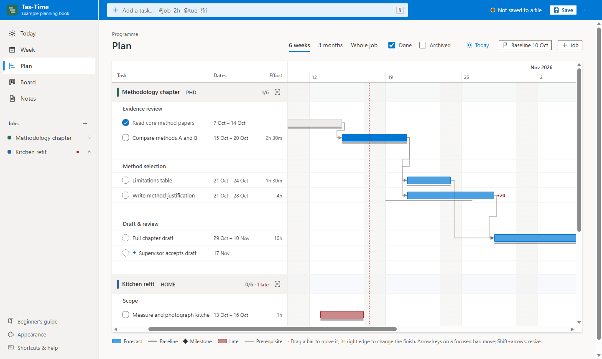
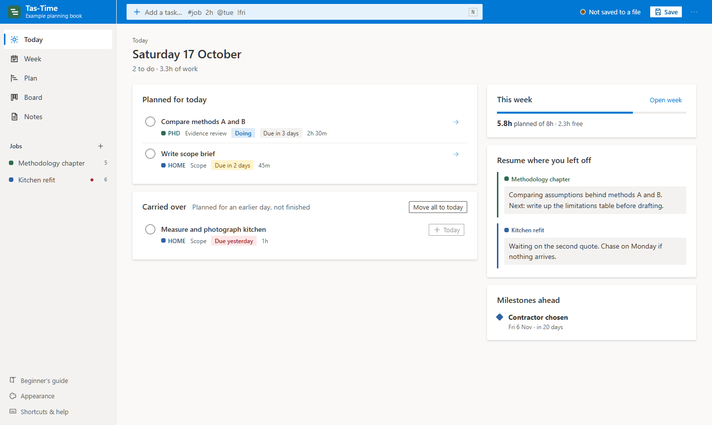
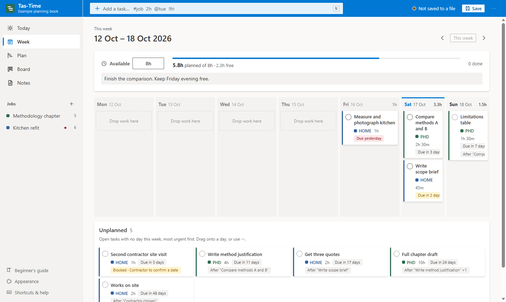

# Tas-Time

**A planning book for people who think in programmes.** Break goals into phases and dated tasks the way a construction planner would, then turn that long view into an honest week and a focused day. Everything runs offline from a single HTML file and saves to a file you own.



## Download

No installation, account or admin rights needed. Pick your computer:

| Your computer | Download | Then |
| --- | --- | --- |
| **Windows** | [**Tas-Time for Windows** (.zip)](https://github.com/spgsu/Tas-Time/releases/latest/download/Tas-Time-Windows.zip) | Right-click the zip → **Extract All**, open the folder, double-click **Open Tas-Time.cmd**. |
| **Mac** | [**Tas-Time for Mac** (.zip)](https://github.com/spgsu/Tas-Time/releases/latest/download/Tas-Time-macOS.zip) | Double-click the zip. The first time, right-click **Open Tas-Time.command** → **Open** → **Open**. After that, just double-click it. |
| **Anything else** | [**Tas-Time.html**](https://github.com/spgsu/Tas-Time/releases/latest/download/Tas-Time.html) | Open the file in Edge or Chrome. |

Each download contains a **START HERE.txt** with these steps. Older versions are on the [releases page](https://github.com/spgsu/Tas-Time/releases).

## Why Tas-Time

Most to-do apps are good at today and bad at the next six weeks. Most project tools are the opposite, and need accounts, servers and a team. Tas-Time sits in between, for one person juggling a few real goals: coursework and a part-time job, a PhD and a family, a renovation and a day job.

- **The long view and the next step, connected.** The same tasks appear on a programme Gantt, in a weekly plan and on today's list. You never copy work between lists.
- **Honest about time.** Effort (your working hours) is tracked separately from duration (calendar days). Each week you set the hours you really have, and the app shows when you have promised more.
- **Nothing reschedules itself.** Dates are forecasts you control. A baseline shows how far they have moved since you first planned.
- **Private by construction.** No account, no server, no network access: the page's security policy blocks it. Your plan is one `.json` file on your disk.

## Getting started

You need **Microsoft Edge or Google Chrome**, version 123 or later (2024 onwards).

1. Download and open Tas-Time as described above.
2. Choose **Explore an example** to look around, or **Create your first job**.
3. Press **Ctrl+S** (**⌘S** on a Mac) once to choose where your planning book is saved. After that, every change saves itself.
4. Keep **Tas-Time.html** and its launcher together in one folder. Your plan is a separate `.json` file wherever you saved it.

**Never planned your time before?** Open **Beginner's guide** at the bottom of the sidebar. It walks through one real project from first idea to finished: writing an outcome, breaking the goal down with a mind map, a fishbone diagram and working backwards from the deadline, then planning weeks and days. The guide is built into the app and works offline. It is also in this repository as [docs/TUTORIAL.md](docs/TUTORIAL.md).

**Windows desktop icon:** Double-click **Create Desktop Shortcut.cmd** in the extracted folder (or `dist/` after building). This creates **Tas-Time** on your desktop with its own icon and opens it in an Edge or Chrome app window. Keep the extracted folder in place; the shortcut points to it. If you move it, run the shortcut creator again.

## How it works

A **job** is a goal with an outcome, such as *Science fair project* or *Kitchen refit*. Jobs have **phases**, phases have **tasks** and **milestones**, and tasks can depend on each other. Six views show that same data at different distances.

| View | Key | What it is for |
| --- | --- | --- |
| **Today** | 1 | What is planned for today, what carried over, what is past due, and a resume note so you can restart in seconds. |
| **Week** | 2 | Your real capacity for the week against the effort you have planned. Drag tasks onto days. |
| **Plan** | 3 | The programme: a Gantt chart by job and phase. Drag a bar to re-forecast, set a baseline, see slippage and prerequisite links. |
| **Board** | 4 | To do, Doing, Blocked and Done at a glance, with job colours. |
| **Notes** | 5 | A notebook per job: resume here, scope, decisions, working notes, references and lessons learned. |
| **Assignments** | 6 | A person's work across jobs, with status/week filters, workload, CSV export and a printable report. |
| **Lookahead** | 7 | Last Planner: which work in the next weeks is ready, who holds the ball on each constraint, RFI or submittal, and Percent Plan Complete. |

<table>
  <tr>
    <td width="50%"></td>
    <td width="50%"></td>
  </tr>
</table>

### Quick add

Press **N** anywhere, type a line and press Enter:

```
Write method section #phd 2h @tue !fri
```

| Code | Meaning | Examples |
| --- | --- | --- |
| `#job` | which job, by code or name | `#phd`, `#kitchen` |
| `2h`, `45m`, `1h30` | effort | |
| `@day` | the day you will work on it | `@today`, `@tue`, `@2026-11-02` |
| `!day` | forecast finish (expected date, not a fixed deadline) | `!fri`, `!2026-11-27` |
| `*` at the start | it is a milestone | `*Supervisor signs off !2026-11-30` |

Days are `today`, `tomorrow`, a weekday name or a date written `YYYY-MM-DD`. A line with an unknown job or day is refused, and your text is kept so you can fix it. Press **?** in the app for every shortcut.

Choose **Job** and optional **Phase** beside quick add, or click **Add task** to open the task editor. Phases group tasks; they are not tasks themselves. In Plan, **Add task to…** stays visible under every group. Use the arrow beside a phase to collapse its tasks. On phones, Plan opens as a readable task list; **Show timeline** switches to the Gantt.

Quick add behaves the same in every view: tasks have no work day unless you include `@day`. For a specific day, use **Add task for today** or **Add task** in a Week day column. Always include effort units (`10h`, `45m`); bare numbers are not accepted in effort fields. One work day receives the whole remaining estimate; split work into smaller tasks for separate sessions.

**On hold** and **Complete** pause a job's tasks in Today and Week without deleting them. Find them in Plan, Board or Notes and set the job to **Active** to restore daily planning. Completing a job with unfinished tasks asks for confirmation.

### People and assignment reports

Open **Assignments → People & capacity** to add people. Rename **Me** to your name; that person remains **My work**. In a task editor, choose its **Assignee** (one responsible person) or **Unassigned**. Global quick add also has an explicit Assignee selector. **Contacts / consulted** is separate, and task Notes remain attached to the task.

In Assignments, select **David** to see **David's assignments** across jobs. Filter by open/doing/blocked/done/past forecast finish, scheduled week, unscheduled work, job or search text. Group by job, assignee, status or work week. **Export CSV** exports exactly the selected tasks, including contacts and notes; **Print report** prints the current selection. Paused jobs are excluded unless explicitly included; archived work is excluded.

Today and Week default to **My work**. Use **Show work for** to choose another person, everyone or unassigned work. Each person's available time covers their active scheduled work across all jobs. Set their normal availability in **People & capacity** and override a particular week in Week. Unassigned work has no capacity and is excluded from the combined capacity calculation. Week intent notes remain shared for the whole book.

Books from older app versions upgrade to **format 4**. Their existing tasks remain in My work, owner/contact text stays in Contacts, and notes and existing weekly capacity are preserved. Save the upgraded book as a new file; apps that only support format 3 cannot open format 4. The original file is kept intact. These are local assignments in one planning book; no emails or notifications are sent.

### Planning rules

- **Prerequisites are finish-to-start.** A task cannot be marked done while a prerequisite is open, and the app refuses dependency loops.
- **Blocked is worked out, never set by hand.** A task is *blocked* when it has a written constraint, or when its start date has arrived and a prerequisite is still open. Before that, it is just *waiting*, shown quietly as "After …".
- **Planning a day never moves programme dates.** The Plan is the forecast; the Week is what you commit to.
- **Mistakes are undoable.** Ctrl+Z (⌘Z) outside a text box reverts any change to the book, including deletes.

### Routine work and checklists

- **Repeating tasks.** In a task editor, set **Repeats** to every N days, weeks or months. When you mark it done, the next one is created with its dates moved on by that interval from the task's own schedule, so finishing early or late keeps the rhythm. Occurrences already in the past are skipped. Only the next occurrence exists at any time, so Plan and Week stay uncluttered. A repeating task with no dates gets a work day one interval after you complete it.
- **Checklists.** Add small steps inside a task. They have no dates or effort, never block completing the task, and show as *2/5 steps* on the task. A repeating task's next occurrence starts with its steps unticked.

### Last Planner: lookahead, ball in court and PPC

The **Lookahead** view (key **7**) follows the Last Planner System used in construction and design.

- **Constraint log.** Log what stands in the way of work: a **constraint**, **RFI**, **submittal**, **approval** or **information** request. Each entry has a number (RFI-001, SUB-002…, per job), a subject, **ball in court** (who has to act next: Owner, MEP engineer, GC…; earlier names are suggested), sent and response-due dates, and the tasks it holds up. Add entries from a task's editor (**Constraints & RFIs → New constraint**) or from Lookahead. A task is blocked while any linked entry is open, and it cannot be marked done until the entry is **Cleared**.
- **Lookahead.** The next 3, 4 or 6 weeks of open work, week by week, with each task marked **Ready** or showing its open constraints. Responses that are overdue, or due after the task is meant to start, are flagged. Open work scheduled before this week counts in this week.
- **Ball in court.** Every open entry grouped by who has to act, the most overdue first. **Export CSV** gives an RFI/submittal log for a meeting; **Print** prints the current tab.
- **Weekly commitment and PPC.** After planning a week in Week, press **Commit this week**. Percent Plan Complete is the share of those committed tasks done by the week's Sunday. Tasks added later or finished after Sunday don't count; deleted tasks leave the measure. **Re-commit** records the plan again if you replan on Monday. In **PPC**, see this week's figure, the trend for the last 12 committed weeks, the average of finished weeks, and record a **reason** for each missed task (prerequisite not done, RFI not answered, submittal not returned, design change, people, estimate, priorities, outside party). The reasons chart shows what most often breaks the plan.

### Finish the day

**Finish the day** in Today shows what you completed, then lets you choose for each unfinished task planned for today or carried over: **Tomorrow**, **Unplan** (back to the unplanned list in Week) or **Leave**. It also shows the resume notes of the jobs you worked on. Nothing moves until you press **Finish the day**, it never changes forecast dates, and Ctrl+Z undoes the whole review.

### Calendar export

**⋯ → Export to calendar (.ics)** saves planned work days, milestones and, optionally, forecast finish dates as a calendar file for Google Calendar or Outlook. Events are all-day and marked as free time, so they never block meetings. Export is one-way: import into a separate *Tas-Time* calendar, and to refresh, delete it and import a new file.

### Appearance

**Appearance** in the sidebar switches between the **Fluent** style (Microsoft 365, the default) and **Notebook** (warm paper), and between light, dark and matching your system. The choice is stored in the browser, not in your planning book.

## Your data

- **One file.** Your planning book is a JSON file at a location you choose. Back it up by copying it, or with **⋯ → Save as…**.
- **Autosave.** After the first save, Edge and Chrome write every change to that file. After restarting the browser, it may ask you to **Reconnect** once.
- **Recovery copy.** The browser also keeps a copy of unsaved work, so closing the window by accident loses nothing. If a linked file is missing recent edits (for example while it waits for **Reconnect**), closing asks first. Turn the recovery copy off in the **⋯** menu on a shared computer; that also deletes the backups below.
- **Edits from elsewhere are never overwritten.** If the book file is saved from somewhere else (another computer through OneDrive or Dropbox, or a second Tas-Time window), autosave stops and the status shows *changed elsewhere*. Choose **Show the file's version**, **Keep this window's version** or **Save as a new file**; the version you don't choose goes into Backups. Coming back to the window loads a newer file automatically when you have no unsaved edits. A second window on the same book is warned about.
- **Backups.** The browser keeps the last 10 versions of each book: one when you open it, then at most every 15 minutes while you work. **⋯ → Backups…** lists them to **Restore** (undoable) or **Download**. They live in this browser only, not beside your file.
- **Resume where you left off.** With recovery enabled, reopening Tas-Time in the same browser and from the same location restores your last book and file link, view, selected job, week, notes page, filters and open task or job panel. The browser may require **Reconnect** to resume saving to the linked file.
- **Older books.** Files from earlier Tas-Time versions open and are upgraded. The original file is never overwritten; you choose where to save the new version.
- **Work and personal.** Keep separate books in separate environments. Tas-Time cannot enforce an employer's rules, so check that running a local HTML file is allowed at work.

### Browser support

| Browser | Works | Autosave to your file |
| --- | --- | --- |
| Edge, Chrome (123+) | Yes, tested | Yes |
| Safari 17.5+, Firefox 120+ | Expected to work, not yet tested | No: **Save** downloads a copy each time |

## Development

Tas-Time is plain JavaScript and CSS with **no runtime or build dependencies**. Node.js **22 or later** is needed only to build and test.

```sh
npm run build   # bundle src/ and docs/ into dist/Tas-Time.html, plus the launchers
npm test        # unit tests: planning logic, file format, calendar export, guide conversion
npm run e2e     # build, then drive the real app in headless Edge or Chrome
npm run check   # all of the above
npm run package # build, then make the release downloads in release/
```

The end-to-end suite controls a real browser through the DevTools protocol: typing quick adds, dragging Gantt bars, saving, reloading, importing old files and switching themes. It needs Edge or Chrome installed, or `BROWSER=<path to a Chromium executable>`. Screenshots of every view, at desktop and phone widths and in dark mode, are written to `.e2e/` for review.

### Project layout

```
src/
  core/          Planning logic with no DOM: dates, model (schema, validation, migration),
                 query (derived state), ops (changes), parse (quick add), store (undo/redo), ics
  ui/            Interface: dom.js (safe element builder), shell, drawer, files (save, open,
                 recovery), overlay (menus, toasts), appearance, export, guide, views/
  index.html     Page template
  styles.css     All styles: Fluent and Notebook, light and dark, print
docs/            Beginner's guide (TUTORIAL.md) and images, bundled into the app at build time
scripts/         build.mjs (bundler), markdown.mjs (guide converter), package.mjs (release zips)
launcher/        Windows (.cmd) and macOS (.command) app-window launchers
tests/           Unit tests (node:test) and e2e/ (headless browser)
dist/            Built app, committed so it can be used without Node
release/         Downloadable zips made by npm run package (not committed; attached to GitHub releases)
```

### Conventions

- **Safety first.** User text only ever becomes DOM text, never `innerHTML`. A strict Content Security Policy blocks all network access.
- **Every change goes through `store.commit()`.** It validates the whole book before accepting a change, and makes it undoable.
- **ES modules with named exports.** The bundler places all modules in one scope and fails the build on duplicate top-level names, default exports or import aliases.
- Two-space indentation, LF line endings (CRLF for `.cmd`), UTF-8.

## License

Copyright © 2026 Selami Pazarbasi. Released under the [MIT License](LICENSE).
