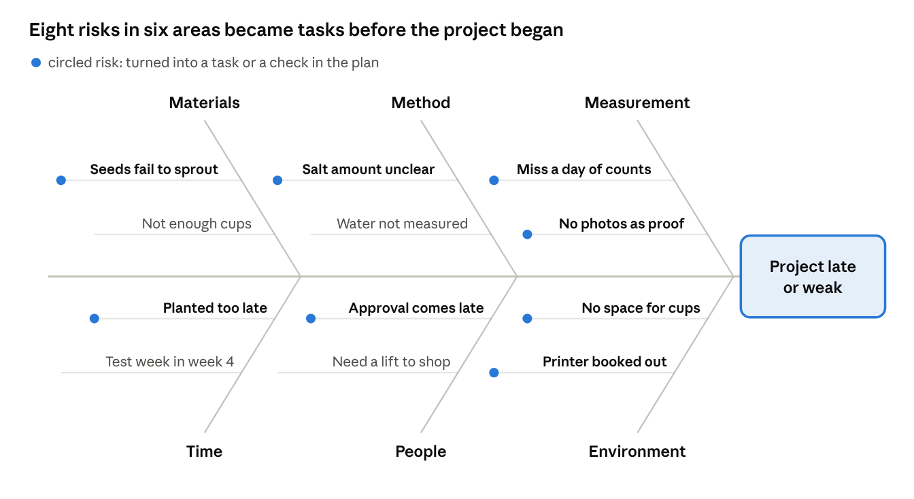
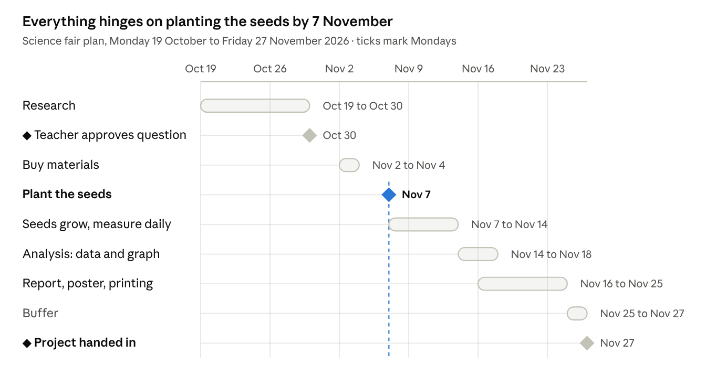
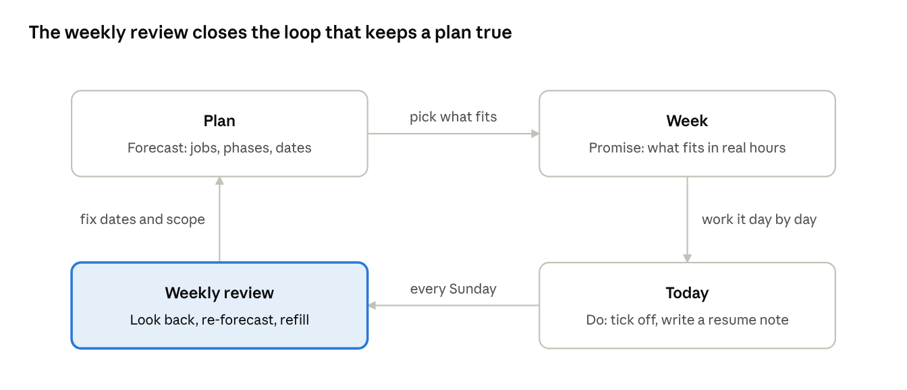

# Planning Your Time with Tas-Time: A Beginner's Guide

*Selami Pazarbasi · October 2026 · for Tas-Time 3.0*

## Welcome

By the end of this guide you will be able to take a big, scary goal, break it into small steps, fit those steps into a real week, and finish on time. No experience needed.

This guide is for anyone who has never planned their time on purpose. Maybe you start assignments the night before. Maybe you have a to-do list but it never seems to shrink. That is normal: nobody is born knowing how to plan. It is a skill, like riding a bike, and you learn it by doing it once, start to finish.

We will use a free app called **Tas-Time**. It runs in your web browser, needs no account, and keeps everything in one file on your own computer.

**The example we follow all the way through:** you have a **science fair project** due in **six weeks**. Your question is *“Does the type of water affect how fast bean seeds sprout?”* You also have school, homework, sports practice twice a week and a Saturday job. We will plan the whole project, from the first idea to handing in the poster, and then look back at what we learned.

You can follow along with your own goal instead: a coursework essay, learning to drive, a fundraiser, training for a 5 km run. Every step works the same way.

**How to use this guide:** read one step, then do that step in the app before moving on. Each step takes 10 to 30 minutes.

## Why plan at all

Planning exists because our brains are bad at two things: guessing how long work takes, and remembering everything at once. A plan fixes both by putting the work on paper where you can see it.

**We underestimate.** Psychologists call it the *planning fallacy*: people almost always think a job will take less time than it really does, even when they have done similar jobs before. “The poster will take an hour” usually means three.

**Effort is not the same as time.** Growing bean seeds takes **7 days of calendar time** but only about **10 minutes a day of your effort** (watering and measuring). Writing the report takes only **3 days** of calendar time but **4 hours of your effort**. A good plan tracks both: when things happen, and how much of *you* they need.

**Small steps beat big goals.** “Do the science fair project” is impossible to start. “Buy 30 bean seeds” takes 15 minutes and you know exactly what to do. Planning is mostly the art of turning the first kind of sentence into lots of the second kind.

### A tiny before and after

| | Without a plan | With a plan |
| --- | --- | --- |
| Week 1 | “Six weeks, loads of time.” | Question chosen, seeds bought. |
| Week 3 | Remembers the project. Panics. | Seeds growing, measuring daily. |
| Week 5 | Seeds planted too late to grow properly. | Results graphed, report drafted. |
| Week 6 | All-nighter, poster half done. | Poster printed two days early. |

The student on the right is not smarter or more hard-working. They just saw, in week 1, that seeds need a week to grow, so that step had to come early.

## The words you need

Tas-Time borrows a few words from construction planning. Here is what each one means, with the science fair example beside it.

| Word | What it means | Science fair example |
| --- | --- | --- |
| **Job** | A goal with a clear end. Anything bigger than a few days of work. | Science fair project |
| **Outcome** | One or two sentences saying what will exist when the job is done. | “A poster and a 2-page report showing whether tap, filtered or salty water changes how fast beans sprout.” |
| **Phase** | A stage of the job. Phases usually happen in order. | Research → Experiment → Analysis → Presentation |
| **Task** | One concrete action you can finish in one sitting. Starts with a verb. | “Buy 30 bean seeds and 9 cups” |
| **Milestone** | A checkpoint that marks something important is finished. It takes no work itself. Shown as a diamond ◆. | ◆ Teacher approves the question |
| **Prerequisite** | A task that must be finished before another can start. | Seeds must be planted before you can measure them. |
| **Effort** | How much of *your* working time a task needs. | Writing the report: 4 h |
| **Duration** | How many calendar days a task spans, including waiting. | Seeds growing: 7 days |
| **Capacity** | The hours you honestly have for planned work in a week. | 6 h this week (it is a test week) |
| **Blocked** | A task that should be moving but cannot, because something is in the way. | Can’t print the poster: school printer is broken. |
| **Baseline** | A snapshot of your original dates, so you can see later what moved. | Saved on day 1 of the project. |

You do not need to memorise these. Come back to this table whenever a word feels fuzzy.

## Setting up Tas-Time (15 minutes)

You need a computer with **Google Chrome** or **Microsoft Edge**. Other browsers work, but only these two can save your plan automatically.

1. Download the app from [github.com/spgsu/Tas-Time](https://github.com/spgsu/Tas-Time): open the `dist` folder and save **Tas-Time.html** to a folder you can find again, such as *Documents/Planning*.
2. Double-click **Tas-Time.html**. If it opens in the wrong program, right-click it and choose *Open with → Chrome* (or Edge).
3. **Look around first.** Click **Explore an example**. This loads a made-up plan so you can see what a finished plan looks like. Click through the five views on the left:
   - **Today** — what to do right now.
   - **Week** — your week, day by day, and how full it is.
   - **Plan** — the big picture, with bars on a calendar.
   - **Board** — cards in columns: To do, Doing, Blocked, Done.
   - **Notes** — a notebook for each goal.
4. **Start your own book.** Click the **⋯** menu at the top right and choose **New book**. Then **Rename book…** and call it something like *My planning book*.
5. **Save it to a file.** Press **Ctrl+S** (or **⌘S** on a Mac). Choose your *Planning* folder and save. From now on, every change saves itself into that file. The top bar shows *Saved · my-planning-book.json*.
6. **Optional:** click **Appearance** at the bottom left to switch between light and dark, or between the *Fluent* and *Notebook* looks.

**Two files, two jobs.** *Tas-Time.html* is the app. Your *.json* file is your plan. Keep both. To open your plan next time, open the app; it remembers your file. If it asks you to **Reconnect**, click once to give permission.

**Back up once a week:** ⋯ → **Save as…** and save a copy with the date in its name, e.g. *planning-2026-10-24.json*.

## Step 1 — Pick one goal and write a clear outcome

Start with one goal, not five. Once you have planned one job from start to finish, adding more is easy.

A goal is only plannable when you can tell, without arguing, whether it is done. So write the **outcome**: what will exist, how good it must be, and by when. Use this checklist:

- [ ] **Concrete:** something you could hold up or show someone.
- [ ] **Measurable:** a number, a page count, a grade, a yes/no.
- [ ] **Dated:** a deadline you cannot move.
- [ ] **Yours:** you control most of it.
- [ ] **Realistic:** someone your age has done something like it.

| Too vague | Clear outcome |
| --- | --- |
| “Do the science fair.” | “By Friday 27 November, a poster and a 2-page report answering: does tap, filtered or salty water change how fast beans sprout? Tested on 30 seeds.” |
| “Get fit.” | “Run 5 km without stopping by 1 March.” |
| “Study more.” | “Finish all 12 chapter quizzes in biology before the exam on 14 December, scoring 70% or more.” |

**Also decide the finish line for “good enough”.** For the science fair: 30 seeds, three water types, measured once a day for 7 days. Not 100 seeds, not five water types. Extra ideas go on a *maybe later* list in your notes. This one decision prevents most last-minute panic.

**Do it in Tas-Time:** you will type this outcome in Step 3, when you create the job. For now, write it on paper or in your head.

## Step 2 — Break the goal down

This is the most important step: turning one big goal into 15 to 30 small tasks. Use the tools below in order, with paper and a pen. Allow about an hour in total. You will not use every tool on every goal, but try each one once.

### Tool 1: Brain dump (5 minutes)

Set a timer for 5 minutes. Write down **everything** the goal might involve, in any order, without judging. Silly items are fine. The point is to empty your head so nothing hides there.

*Example:* beans, cups, which water?, ask teacher, graph, poster, printer, salt, measuring ruler, report, photos, what if seeds don’t grow?, where do I keep them?

### Tool 2: Mind map (10 minutes)

Write the goal in the middle of a page and circle it. Draw branches for the main areas of work, then smaller branches for details. Move your brain-dump items onto the branches. Missing branches show you work you forgot.

For the science fair, four branches appear naturally: **Research**, **Experiment**, **Analysis** and **Presentation**. Those become your **phases**.

### Tool 3: Work breakdown — the 2-hour rule (15 minutes)

Take each branch and keep splitting it until every piece passes three tests:

1. It starts with a verb: *buy, write, measure, email, print*.
2. You could finish it in one sitting, ideally **under 2 hours**.
3. You would know exactly what to do first if you sat down now.

“Do the report” fails all three. “Write the method section (half a page)” passes. If a task is bigger than 2 hours, split it again. If you cannot think of the first action, the task is still too vague.

### Tool 4: Fishbone diagram — what could go wrong? (15 minutes)

A fishbone diagram (also called an *Ishikawa diagram*, after the Japanese engineer Kaoru Ishikawa) was invented to find the causes of a problem in a factory. Planners use it **before** the work starts, to find hidden tasks and risks.

How to draw one:

1. Write the problem you want to avoid at the head of the fish, on the right: *“Project late or weak.”*
2. Draw a spine to the left, then six bones. Label them with these categories: **Materials, Method, Measurement, Time, People, Environment**.
3. For each bone, ask: *“What in this category could make the project late or weak?”* Write each answer as a small bone.
4. Circle the causes that are likely **or** would be serious.
5. Turn every circled cause into either a **task** (to prevent it) or a **note** (to watch for).

The diagram below shows the science fair fishbone. The circled causes became new tasks that were not in the mind map at all, such as *buy 10 spare seeds* and *book the school printer early*.

Read it from the head: each bone is a category, each rib a possible cause. The eight circled causes turned into tasks or checks, such as *buy 10 spare seeds*, *ask at home where the cups can stay* and *book the printer in week 4*.

### Tool 5: The 5 Whys (5 minutes)

For any cause that worries you, ask “why?” up to five times to reach the root.

- The poster might be late. *Why?* Printing takes time. *Why?* Only the school printer does large paper. *Why is that a problem?* It is busy in the last week before the fair.
- **Root cause:** everyone prints in the same week. **Task:** book a printing slot in week 4.

### Tool 6: Pre-mortem (5 minutes)

Imagine it is the day after the deadline and the project went badly. Write the story of what happened: *“The seeds went mouldy in week 3 and I had to start again.”* Each story points to a task or a buffer: *check seeds daily; plant 10 extra*.

### Tool 7: Work backwards from the deadline (10 minutes)

Start at the deadline and ask, step by step: *what must be done just before this?* Write the dates as you go.

- Fair: Friday 27 Nov → poster printed by **Wed 25 Nov** (2-day safety margin)
- → poster designed by **Sun 22 Nov** → graph made by **Mon 16 Nov**
- → measuring finished by **Sat 14 Nov** → seeds planted by **Sat 7 Nov**
- → materials bought by **Wed 4 Nov** → question approved by **Fri 30 Oct**

Working backwards shows the hard truth fast: the seeds must be planted in **week 3**, no later. That is your most important date.

### What you end up with

After the seven tools, the science fair breaks down into this list. Effort is *your* working time; the growing time is not effort.

| Phase | Task | Effort | Came from |
| --- | --- | --- | --- |
| Research | Choose a question and list three options | 45m | Mind map |
| Research | ◆ Teacher approves the question | — | Work backwards |
| Research | Read 3 sources on seed germination | 1h 30m | Mind map |
| Research | Write hypothesis and method (half a page) | 1h | Work breakdown |
| Experiment | Buy 40 seeds, 9 cups, labels, salt, ruler | 45m | Fishbone (spare seeds) |
| Experiment | Ask at home where cups can stay for 2 weeks | 10m | Fishbone (environment) |
| Experiment | Plant seeds and label cups | 1h | Mind map |
| Experiment | Measure and record sprouts daily for 7 days | 1h 10m | Work breakdown |
| Experiment | Photograph the setup on day 1 and day 7 | 15m | Fishbone (evidence) |
| Analysis | Enter data into a spreadsheet | 45m | Work breakdown |
| Analysis | Make the graph | 45m | Mind map |
| Analysis | Write results and conclusion | 2h | Work breakdown |
| Presentation | Book a slot on the school printer | 10m | 5 Whys |
| Presentation | Write the 2-page report | 3h | Mind map |
| Presentation | Design the poster | 3h | Mind map |
| Presentation | Print the poster | 30m | Work backwards |
| Presentation | Practise a 2-minute talk | 45m | Pre-mortem |
| Presentation | ◆ Project handed in | — | Outcome |

Total effort: about **17 hours** over six weeks, roughly **3 hours a week**. That is very doable, but only if it starts in week 1.

**Keep your thinking:** type the brain dump, fishbone causes and pre-mortem story into the job’s **Working notes** page in Tas-Time (Notes view) once the job exists. Its hint text reminds you what goes there.

## Step 3 — Put the plan into Tas-Time

Now the paper plan goes into the app. This takes about 20 minutes and you only do it once per goal.

### Create the job

1. In the sidebar, next to **Jobs**, click **+**. A panel opens on the right.
2. **Name:** *Science fair project*.
3. **Outcome:** paste your outcome from Step 1.
4. **Short code:** *SCI*. You will type this to send tasks to this job.
5. **Colour:** pick one. Every card for this job will carry it.
6. **Phases:** type *Research*, press Enter. Then *Experiment*, *Analysis*, *Presentation*.

There is no Save button in the panel: everything saves as you type. Press **Esc** to close it.

### Add tasks quickly

The box at the top of the screen is **quick add**. Press **N** to jump into it, type a task, press **Enter**. Little codes let you fill in details in the same line:

| Type this | It means | Example |
| --- | --- | --- |
| `#code` | which job | `#sci` |
| `2h`, `45m`, `1h30` | effort | `1h30` |
| `@day` | the day you will work on it | `@tue`, `@tomorrow` |
| `!day` | expected forecast finish, not a fixed deadline | `!fri`, `!2026-11-07` |
| `*` at the start | it is a milestone | `*Teacher approves question` |

Examples:

- `Read 3 sources on seed germination #sci 1h30`
- `Buy 40 seeds, 9 cups, labels, salt, ruler #sci 45m !wed`
- `*Teacher approves the question #sci !2026-10-30`

If you mistype a code, the app refuses to add the task and tells you why, so nothing ends up in the wrong place.

Choose the **Job** and optional **Phase** below quick add before typing, or use **Add task** to open the task editor. Quick add leaves the work day empty unless you include `@day`, in every view. Use **Add task for today** or a day column's **Add task** button to schedule directly. Effort fields require units such as `10h` or `45m`.

**Faster for a whole phase:** open the **Plan** view. Under each phase there is a visible **Add task to Research** line. Click it and type tasks one after another, pressing Enter each time. They go straight into that phase. A phase is an optional group of tasks, not a task itself. Its arrow collapses the tasks. On a phone, Plan shows a readable task list with dates; use **Show timeline** for the Gantt.

### Estimate effort honestly

- Think of a similar task you have done. How long did it *really* take?
- Add 50% for anything new to you. Writing usually takes double.
- Under 15 minutes? Merge it with another task. Over 2 hours? Split it.
- Unsure? Guess anyway. A rough number is far more useful than no number, and you can fix it later.

### Link the prerequisites

Some tasks cannot start until others are done. Click a task to open its panel, then under **Prerequisites** choose **Add a prerequisite…**.

For the science fair:

- *Plant seeds* needs *Buy seeds, cups…* and *◆ Teacher approves the question*.
- *Measure daily for 7 days* needs *Plant seeds*.
- *Make the graph* needs *Enter data*, which needs *Measure daily*.
- *Print the poster* needs *Design the poster* and *Book a printer slot*.

The app will not let you create a loop (A needs B needs A), and it will not let you tick off a task whose prerequisites are unfinished.

### Write constraints in plain words

If something outside your control holds a task up, write it in **Waiting on / constraint**. Example: *“Teacher is away until Tuesday.”* The task now shows as **Blocked** until you clear that text.

## Step 4 — Schedule it on the Plan, then freeze a baseline

Give every task a start and a finish date so you can see the whole job on a calendar. Open the **Plan** view. Each task is a row; each dated task is a bar.

1. **Start with the fixed dates.** The deadline and anything else you cannot move: the milestone *◆ Project handed in* on 27 Nov, and *◆ Teacher approves the question* on 30 Oct.
2. **Then the long waits.** The seeds need 7 days to grow, so *Measure daily* runs from 7 to 14 November. Put things that take calendar time early; they cannot be rushed.
3. **Then fill in the rest**, working backwards from the deadline as in Tool 7.
4. **Leave a buffer.** Aim to finish 2 to 3 days before the real deadline. Things will go wrong; the buffer is where they go.

To set dates, either click a task and type the **Forecast start** and **Forecast finish**, or, on an undated row, click the calendar where it should start. These are expected dates, not fixed deadlines. Then **drag** the bar to move it, or drag its **right edge** to make it longer or shorter. Arrow keys nudge a selected bar by one day.

**Reading the Plan:** grey lines between bars show prerequisites. A line turns red and dashed if a task is scheduled to start before its prerequisite finishes, so you spot impossible plans at once. The red dotted line is today. Bars turn red when their finish date has passed and they are not done.

The science fair laid out this way: the seeds need a full week to grow, so planting on 7 November is the date everything else depends on. The last two days are a deliberate buffer.

### Freeze a baseline

When the plan looks right, click **Set baseline** at the top of the Plan. Tas-Time takes a snapshot of every date. From now on, each bar shows a thin grey line where it was *originally* planned, and a label like **+3d** when it has slipped three days.

The baseline is not a punishment. It is a mirror: it shows how good your estimates were, so your next plan is better. Only reset it if the whole plan changes, for example when the teacher moves the deadline.

## Step 5 — Plan your week (every Sunday, 15 minutes)

The Plan shows *when* things should happen. The Week view answers a different question: *does this week actually have room for them?* Most plans fail here, because people plan as if they had unlimited time.

### Count your real hours

Look at your week and find the blocks of time you could realistically give to planned work, after school, homework, practice, your job, meals, family and rest. Be honest; rest is not optional.

| Day | Fixed stuff | Free for the project |
| --- | --- | --- |
| Mon | School, homework | 45m |
| Tue | School, practice until 6:30 | 0 |
| Wed | School, homework | 1h |
| Thu | School, practice until 6:30 | 0 |
| Fri | School, evening with friends | 0 |
| Sat | Job 9:00–14:00 | 1h |
| Sun | Family lunch | 1h 30m |
| **Total** | | **4h 15m** |

Now plan only about **three quarters** of that, because something always comes up: **about 3 hours**. That number is your **capacity**.

### Fill the week in Tas-Time

1. Open **Week**. Type your capacity in **Available**, e.g. `3h`.
2. Under the days, the **Unplanned** list shows open tasks that have no day yet, most urgent first.
3. **Drag** a task onto the day you will do it, or click its **⋯** and pick a day. Match tasks to your free blocks: a 1-hour task goes on Wednesday, not Tuesday.
4. Watch the bar at the top. It shows hours planned against hours available. If it turns **red**, you have planned more than you have. Move something to next week now, not on Thursday night.
5. In the box under the bar, write one sentence of **intent**: *“This week: question approved and materials bought. The reading can wait.”*

Putting a task on a day never changes its dates on the Plan. The Plan is the forecast; the Week is your promise to yourself.

**Test weeks and busy weeks:** lower your capacity, even to zero. A plan that admits a busy week is still a good plan. A plan that ignores it just fails quietly.

## Step 6 — Run your day (2 minutes to start, 2 minutes to stop)

On a planned day, open Tas-Time. It opens on **Today**.

### Starting a session

1. Read **Planned for today**. That is your whole job for this session; ignore everything else.
2. Read **Resume where you left off** on the right. It is the note you wrote last time.
3. Click a task to start. If you like, set its status to **Doing** in the panel, so the Board shows what you are on.
4. Work in one block. Phone in another room. A 25-minute timer with a 5-minute break works for most people.

### Finishing a session

1. **Tick the circle** next to each finished task. A task that still needs work stays open: update its **Effort left** (e.g. from `2h` to `45m`).
2. **Write the resume note.** This is the single most useful habit in this guide. Three short lines:
   - Where I stopped: *“Method section half written, stopped at the watering schedule.”*
   - What is unclear: *“How much salt per cup? Ask Ms Diaz.”*
   - Next action: *“Finish the watering schedule paragraph.”*
3. Close the app. It has already saved.

Next time you will start in seconds instead of spending 20 minutes remembering where you were.

### What the other lists on Today mean

- **Carried over:** tasks you planned for an earlier day but did not finish. Click **Today** on one to move it here, or **Move all to today**. Do not just ignore them; decide.
- **Past forecast finish:** tasks whose expected finish has passed. Either finish them now, or re-plan their dates honestly (Step 7).
- **Milestones ahead:** checkpoints coming in the next four weeks, so they never surprise you.

**Adding something new during the day?** Press **N**, type it, press Enter. Add `@today` to put it on today’s list. Capturing it takes 5 seconds and clears your head.

## Step 7 — When things go wrong

Something will go wrong. That is not failure; it is what the plan is for. A plan lets you see the problem early, while you still have choices.

### Blocked or just waiting?

Tas-Time separates two situations that feel the same but are not:

- **Waiting:** a task’s prerequisite is not finished yet, but the task is not due to start anyway. *Make the graph* waiting for *Measure daily* in week 2 is normal. It shows quietly as **After “Measure daily…”**.
- **Blocked:** the task *should* be moving and cannot. Either it has a written constraint (*“Printer broken”*), or its start date has arrived and a prerequisite is still open. It goes into the **Blocked** column on the Board.

Check the **Board** once a week. Every card in Blocked needs an action from you: chase someone, find a workaround, or re-plan.

### You are behind. Now what?

*Example: in week 3 the seeds go mouldy. You must replant, which pushes measuring back 5 days.*

Work through these options in order. The first ones cost the least.

1. **Use your buffer.** This is why you planned to finish 2 to 3 days early.
2. **Re-forecast honestly.** On the Plan, drag the affected bars to their new dates. The prerequisite lines show what else has to move. The baseline shows **+5d** so you remember why.
3. **Find more time this week.** Raise your capacity a little, for one week only. Not every week.
4. **Cut scope.** Go back to your *good enough* line from Step 1. Could you measure for 5 days instead of 7? Skip the spoken practice? Write down what you cut in the job’s **Decisions** notes.
5. **Ask for help.** A teacher, a parent, a friend. Asking early is a skill, not a weakness.
6. **Ask to move the deadline.** Last, and only with a plan in hand: *“My seeds failed on 10 Nov; with a 3-day extension I can still test all three water types.”*

### What never helps

- Ignoring red items and hoping.
- Planning a 9-hour week to catch up. You will not do it, and the plan will stop meaning anything.
- Deleting the plan and starting from memory.

## Step 8 — The weekly review (Sunday, 15 minutes)

The weekly review is the habit that keeps a plan alive. Without it, a plan is accurate for about one week and then quietly becomes fiction.

The Plan feeds the Week, the Week feeds each day, and the review feeds what you learned back into the Plan. Skip the review and the loop breaks.

Do it at the same time every week, for example Sunday after dinner. Go through this list in order:

- [ ] **Empty your head.** Press **N** and add anything new you have been carrying around: homework, promises, ideas.
- [ ] **Look back at last week** in the **Week** view (use ←). What got done? What did not, and why? One honest sentence in the week’s intent box is enough.
- [ ] **Clear the Board.** Every card in **Blocked**: decide the next action. Every card in **Doing** that you have not touched for a week: is it really in progress?
- [ ] **Check the Plan.** Any red bars (late)? Any red dashed lines (impossible order)? Drag them to honest new dates.
- [ ] **Update effort left** on anything half done.
- [ ] **Set next week’s capacity.** Look at the calendar: tests, trips, birthdays. Type the real number.
- [ ] **Fill next week.** Drag tasks from **Unplanned** onto days until the bar is about full, not more.
- [ ] **Write next week’s intent** in one sentence.
- [ ] **Back up:** ⋯ → Save as… with the date in the file name.

The first few reviews take 30 minutes. After a month they take 10.

## Step 9 — Finishing well

A job is not finished when the last task is ticked. It is finished when you have closed it properly and kept what you learned. This takes 20 minutes and makes every future plan better.

### Close the job

1. **Tick the final milestone,** *◆ Project handed in*. Tas-Time records the date it was completed.
2. **Check for leftovers.** On the **Plan**, make sure *Done* is ticked so finished work shows, and look for anything still open. Either finish it, or delete it if it no longer matters.
3. **Mark the job Complete.** Click the job name, and under **Status** choose **Complete**.

On hold and Complete pause the job's tasks in Today and Week. Plan, Board and Notes keep them accessible. Completing with unfinished tasks asks for confirmation; those tasks are kept. Set the job back to Active to resume daily planning. Use **Edit job** in the filter banner, or click the job title in Plan. On phones, the **⋯** menu includes job selection, New job, help and appearance.
4. **Archive it.** In the job panel, click the archive icon. The job disappears from your daily views but nothing is lost: on the Plan, tick **Archived** to see it again, and restore it from its panel at any time.

### Hold a short retrospective

Open **Notes**, choose the job and the **Lessons learned** page. Answer four questions in a few lines each:

- **What went well?** *“Planting in week 3 left time to replant when the seeds went mouldy.”*
- **What went badly?** *“The report took 5 hours, not 3.”*
- **What surprised me?** *“Printing was booked out four days ahead.”*
- **What will I do differently next time?** *“Double my estimate for anything involving writing.”*

When you start your next job, its **Lessons learned** page shows these answers under *Lessons from earlier jobs*, so you plan with them in front of you.

### Learn from your own numbers

Before archiving, look at the Plan with the baseline. The **+Nd** labels tell you which kinds of tasks you underestimate. Most beginners find that **writing** and **anything that depends on other people** take about twice as long as planned. Use your real numbers to estimate the next job.

### Celebrate

Seriously. You took a six-week goal from nothing to finished, on purpose. That is the skill. The next goal will be easier, and the one after that easier still.

## Keeping it going

Once one job works, use the same book for everything with a deadline: coursework, exam revision, a driving test, a club event. Three or four jobs at once is plenty. Each one gets its own colour, and the Week view adds up effort across all of them, so you see when the week is too full.

### Put plans in your calendar (optional)

⋯ → **Export to calendar (.ics)…** saves your planned work days and milestones as a calendar file. Import it into Google Calendar or Outlook, into a separate calendar called *Tas-Time*. It is one-way: when plans change, delete that calendar and import a fresh export. The dialog’s *How to import* section has the exact steps.

### Common beginner mistakes

| Mistake | Fix |
| --- | --- |
| Tasks like “Work on project” | Start with a verb, under 2 hours, first action obvious (Step 2, Tool 3). |
| Planning every free minute | Plan three quarters of your real capacity (Step 5). |
| Skipping the weekly review | Same time every week, 15 minutes, checklist in Step 8. |
| No resume note | Two minutes at the end of every session (Step 6). |
| Hiding from red items | Red is information. Re-forecast or cut scope (Step 7). |
| Long waits planned late | Put anything that needs calendar time (growing, posting, other people) first (Step 4). |
| One giant to-do list | Split goals into jobs and phases; plan the week from them. |

### Cheat sheet

| Do this | Press or click |
| --- | --- |
| Add a task from anywhere | **N**, type, **Enter** |
| Switch views | **1** Today · **2** Week · **3** Plan · **4** Board · **5** Notes |
| Save / Save as | **Ctrl+S** / **Ctrl+Shift+S** (Mac: ⌘S / ⇧⌘S) |
| Undo a mistake | **Ctrl+Z** (Mac: ⌘Z), outside a text box |
| Close a panel | **Esc** |
| Previous / next week | **[** and **]** on the Week view |
| Move a selected bar on the Plan | **← →**; **Shift + ← →** changes its finish |
| See every shortcut | **?** |

### The whole method on one line

**Goal → outcome → break it down → put it in the app → schedule and baseline → plan the week → work the day → review weekly → finish and learn.** Then pick the next goal.

---

Copyright © 2026 Selami Pazarbasi. Part of [Tas-Time](https://github.com/spgsu/Tas-Time), released under the MIT License.
